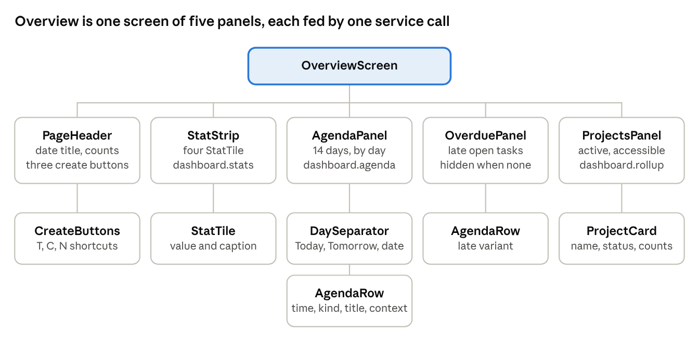
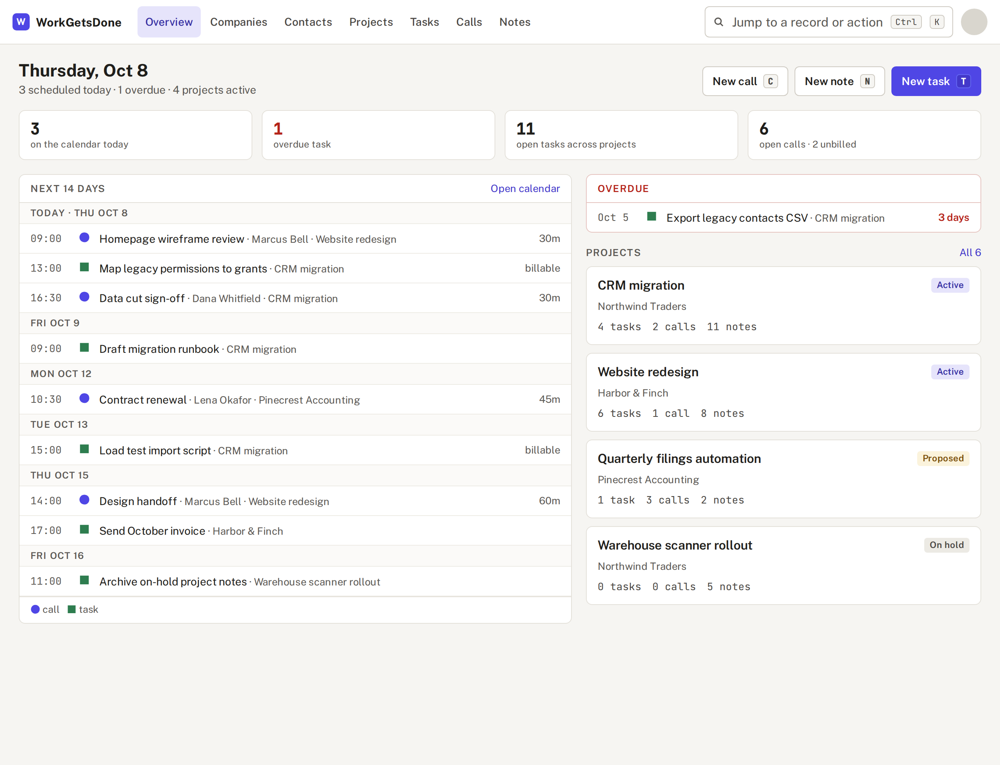
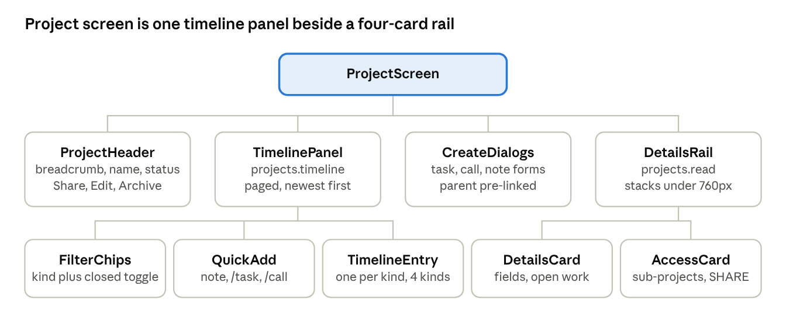
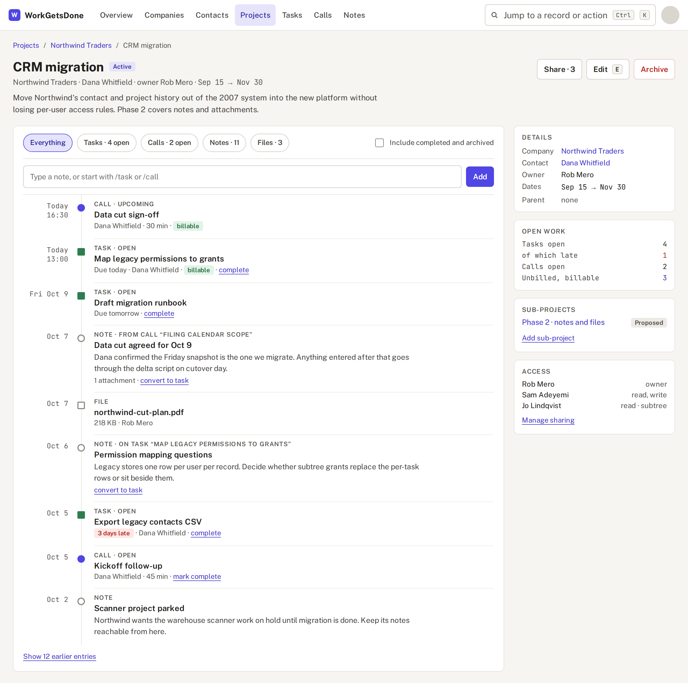

# WorkGetsDone React front-end: component spec

2026-10-08 · Rob Mero, with Claude

This spec turns the chosen mockups (row D of the WorkGetsDone front-end directions canvas, https://claude.ai/artifact/R5MJsewM1LYLKWRCRJnFtX) into components, data contracts and build constraints for the bring-your-own-front-end client on MeroFoundry. The living copy is the Claude Doc at https://claude.ai/code/artifact/df8b905f-53a9-433b-b2ee-78e9aa08d3f5; this file is its export. Mockup renders are in `images/`.

## Scope and decisions

Row D is the Console layout in the Planner palette, chosen by Rob on 2026-10-08: a top bar with a command palette and single-key shortcuts, an Overview screen built around a 14-day agenda list rather than a calendar grid, and a Project screen built around one merged timeline. This spec covers those two screens plus the shell and primitives they share. The remaining list and detail screens (companies, contacts, tasks, calls, notes, files, sharing, sign-in) reuse the same primitives and services and are specified later.

| Decision | Value |
| --- | --- |
| Landing view | Overview with the agenda list; the 7×2 calendar grid moves behind the "Open calendar" link (FR-DASH-01 still satisfied there) |
| Framework | React 18 with TypeScript, Vite, React Router; no component library, styles from tokens via CSS custom properties |
| Data | Same-origin fetch helper only; every call goes to an application-defined service (BYOF-01, BYOF-03) |
| Identity | Server-held session cookies; the client never reads a token and learns signed-in state only from the current-user service (BYOF-07) |
| Styling source | One `tokens.css` generated from `design/tokens.json`; no literal colour or size anywhere else (UI-10) |
| Icons | Inline SVG React components; no `.svg` files in the bundle (BYOF-12) |
| Mock data | None in the product; a `fixtures/` folder mirrors the service shapes for Storybook and tests only |

Out of scope here: the services' implementation inside MeroFoundry, migration, and the application MCP tools. They are referenced where the client depends on them.

## Design tokens

These replace the colour block in `design/tokens.json`; the type, space, radius and shadow blocks there stay as they are except the font family. Contrast is against the surface the token is used on; every text pair clears WCAG 2.1 AA at 4.5:1, every control outline clears 3:1.

| Token | Value | Use | Contrast |
| --- | --- | --- | --- |
| bg | #F6F5F2 | page ground (warm paper) | base |
| surface | #FFFFFF | panels, cards, inputs | base |
| surfaceSunken | #FBFAF8 | day separators, hover rows | base |
| border | #E4E1DA | panel edges, dividers (decorative) | 1.2:1 |
| borderControl | #CFCBC3 | input and button outlines | 3.2:1 on surface |
| text | #1F1E1B | body, headings, numbers | 16.7:1 on bg |
| textSecondary | #5C5955 | metadata, labels, section captions | 7.0:1 on bg |
| accent | #4F46E5 | primary button, active nav, call marker | 6.3:1 white on it |
| accentHover | #4338CA | links, primary hover | 7.6:1 on bg |
| accentSubtle | #E6E4FB | active nav fill, active chip fill, Active tag | with #3730A3 text 8.9:1 |
| onAccent | #FFFFFF | text on accent | 6.3:1 |
| taskMarker | #2E7D4F | task square marker and Billable tag text on #E3F3E8 | 5.2:1 on surface |
| danger | #B42318 | overdue text, Archive button text | 6.6:1 on surface |
| dangerSubtle | #FDE8E6 | Late tag fill, overdue panel edge #E6C5C1 | with danger text 6.0:1 |
| warnSubtle | #FBF3DC | Proposed tag fill, with #7A4E07 text | 7.0:1 |
| focus | rgba(79,70,229,.45) | 3px focus ring on every control | n/a |

| Type | Value |
| --- | --- |
| Sans | Public Sans 400/500/600/700, system-ui fallback |
| Mono | JetBrains Mono 400/500, used only for times, dates, counts (tabular numerals) |
| Sizes | 11.5 caption-caps (letter-spacing .06em, uppercase) · 13 meta · 14 body · 15 entry title · 20 stat · 22 to 24 page title |
| Radii | 4 tags · 6 controls and chips (pill for chips) · 8 panels and cards |
| Spacing | the existing 4/8/12/16/24/32/48/64 scale; panel padding 14, page gutter 24, section gap 18 |

Markers are shape plus colour so kind is never carried by hue alone: call is a filled accent circle, task a filled green square, note an outlined circle, file an outlined square.

## App shell

The shell is identical on every signed-in screen (UI-11): one `AppShell` component that owns the top bar and renders the route's screen below it in a centred column of at most 1400px with a 24px gutter. There is no sidebar.

| Component | Renders | Props and behaviour |
| --- | --- | --- |
| `TopBar` | brand tile and wordmark, `PrimaryNav`, `CommandTrigger`, `AccountMenu` | 56px tall, white, hairline bottom; wraps to two rows under 760px |
| `PrimaryNav` | Overview, Companies, Contacts, Projects, Tasks, Calls, Notes | `<nav aria-label="Main">` of router links; the active one gets the accentSubtle fill and `aria-current="page"` |
| `CommandTrigger` | a button styled as a search field with the Ctrl K hint | opens `CommandPalette`; the only search entry point in the shell |
| `CommandPalette` | modal with one input and a result list grouped by kind (companies, contacts, projects, tasks, calls, notes, actions) | queries the `search` service after 2 characters, debounced 150ms; results are permission-filtered by the service, never by the client; actions are the three creates plus Sign out; Escape closes, arrows move, Enter opens |
| `AccountMenu` | avatar button | menu with the signed-in name, Change password, Sign out |
| `ShortcutHints` | the `<kbd>` badges on buttons | purely visual; the bindings live in `useShortcuts` |

`useShortcuts` registers the single-key bindings only while focus is outside any input, textarea or contenteditable, and never while the palette or a dialog is open:

| Key | Action |
| --- | --- |
| Ctrl K (Cmd K on Mac) | open the command palette |
| T | new task (pre-linked to the current project when on a project screen) |
| C | new call (same pre-link rule) |
| N | new note (same pre-link rule) |
| E | edit the current record, on detail screens only |
| Escape | close the topmost dialog or palette |

The brand tile is a 22px indigo square with a white W; the real mark comes later and must be inline SVG, not a file (BYOF-12).

## Overview screen

Route `/`. Three service calls on load (stats, agenda, rollup), all in parallel; each panel renders its own loading, error and empty state so one failed call never blanks the screen (BYOF-15).

The screen is five panels under one header; AgendaRow is shared by the agenda and the overdue panel, and every panel maps to exactly one dashboard service.

| Component | Data it needs | Behaviour |
| --- | --- | --- |
| PageHeader | today's date; counts of today's items, overdue, active projects (from stats) | title is the long date; subtitle is the three counts in words; buttons open the create dialogs with no parent pre-linked |
| StatStrip / StatTile | `stats`: todayCount, overdueCount, openTasks, openCalls, unbilledCalls | tabular numerals; the overdue tile uses danger colour only when above zero; tiles are not links |
| AgendaPanel | `agenda`: items for the 14-day window from the most recent Sunday (FR-DASH-02), each with kind, startAt, title, personName, projectName, companyName, durationMinutes, billable, href | groups by day in order; a day with nothing is skipped except Today, which shows an empty state; the footer key explains the two markers; "Open calendar" links to `/calendar`, the 7×2 grid |
| OverduePanel | `agenda.overdue`: open tasks with a due date before today | rendered only when non-empty; rows carry "N days" in words and danger colour |
| ProjectsPanel / ProjectCard | `rollup`: accessible, non-archived projects with company, status, openTasks, openCalls, notes (FR-DASH-08, counts from aggregates per FR-DASH-09) | cards sorted by most recent activity; shows the first six with "All N" linking to `/projects` |
| AgendaRow | one agenda item | a single link to the record; time in mono, marker by kind, context in textSecondary, right slot shows duration, "billable" or days late |

Empty states: no items in the window shows "Nothing scheduled through Oct 17" with the two create actions; no projects shows "No projects you can see yet" with New project. Neither reveals that inaccessible records exist (UI-16).

## Project screen

Route `/projects/:id`. Two calls on load: `projects.read` for the header and rail, `projects.timeline` for the panel. A refused read renders the not-found screen, never a forbidden one (BYOF-09).

The timeline replaces the brief's three stacked sections with one list; the open-by-default rule survives as the "Include completed and archived" toggle, off by default, and the per-section counts survive on the chips.

| Entry kind | Marker | Shows | Inline actions |
| --- | --- | --- | --- |
| task | green square | caption "Task · open" or "completed"; title link; due date in words (today, tomorrow, N days late); contact; Billable tag | complete / reopen |
| call | indigo circle | caption "Call · upcoming", "open" or "completed"; subject link; callee; duration only when both endpoints exist (FR-PRJ-04); Billable tag | mark complete / reopen |
| note | outlined circle | caption "Note" plus its source ("from call …", "on task …") when attached to a child; description as title; body, plain text, 68ch; attachment count | convert to task, archive |
| file | outlined square | caption "File"; filename link that downloads; size; uploader | delete (confirm) |

Entries sort by their own date: due date for tasks, start for calls, occurred-at for notes, created-at for files; ties by created-at. Dates in the left column are relative within 7 days and absolute beyond. The panel pages 25 entries at a time; "Show N earlier entries" appends the next page.

QuickAdd grammar: plain text creates a note on the project. A leading `/task ` creates a task with the rest as its name; `/call ` creates a call with the rest as its subject; both open the matching create dialog with the name pre-filled so dates and contacts can be set, and the note path saves directly. The field keeps focus after a save and the new entry appears at the top (FR-NAV-01's return-to-context rule).

FilterChips are a radio group (Everything, Tasks, Calls, Notes, Files) persisted per session with the toggle (UI-04). Counts on the chips are the open or active counts from `projects.read`, not the timeline page.

DetailsRail cards: Details (company, contact, owner, dates, parent); Open work (tasks open, of which late, calls open, unbilled billable); Sub-projects (name, status, add); Access (people with their bits in words), rendered only when the viewer holds SHARE (UI-09), with "Manage sharing" opening the grants dialog.

## Shared primitives

Every screen is composed from these; none of them knows about a service. States are defined once here (UI-15) and never restyled per screen.

| Primitive | Variants | States it must define |
| --- | --- | --- |
| `Button` | primary (accent, white text), secondary (white, borderControl), danger (white, danger text), size default 38px and compact 34px; optional `<kbd>` hint slot | hover (darker accent or darker border), active, focus ring, disabled (60% opacity, no hover), busy (spinner replaces the label, width held) |
| `LinkButton` | inline text action in accentHover, underlined | hover, focus ring; used for complete, reopen, convert, archive, show more |
| `Chip` | radio-style filter, pill, borderControl | selected (accentSubtle fill, accent border, #3730A3 text), hover, focus; grouped in a `role="radiogroup"` |
| `Tag` | neutral, active (accentSubtle), billable (green on #E3F3E8), late (danger on dangerSubtle), proposed (warnSubtle) | static; text always carries the meaning, never the colour alone |
| `Panel` | white, border, radius 8; optional `PanelHeader` with a caps caption and a right-side action | none; a danger-edged variant for the overdue panel |
| `Marker` | call, task, note, file | static; 10px, shape plus colour as the tokens section says |
| `KindCaption` | the 11.5px caps line ("Task · open") | static |
| `Field`, `TextInput`, `Select`, `DatePicker`, `EntityPicker` | labelled form controls; EntityPicker searches a service and is permission-filtered (UI-05) | hover, focus ring, invalid (danger border and message), disabled |
| `Dialog` | modal with title, body, footer actions; traps focus; Escape closes unless busy | used for create and edit forms and for destructive confirms (UI-06) |
| `Toast` | success or error, 4s, dismissible | announced via `aria-live="polite"` |
| `EmptyState` | panel-level: one sentence saying what the list holds, one or two actions | required by every list (UI-16) |
| `ErrorState` | panel-level: what failed in plain words and a Retry button | required by every panel; visually distinct from EmptyState (BYOF-15) |
| `LoadingState` | skeleton rows matching the panel's row height | shown after 150ms to avoid flicker |
| `Kbd` | the shortcut badge | static |

Touch targets are at least 40px tall on every control; icon-only buttons carry `aria-label`. All colours come from tokens.css; a primitive that needs a value not in the table is a token request, not a hex.

## Services

Every browser read and write goes through an application-defined service on the same origin (BYOF-01, BYOF-03). Each service checks the caller's effective permission itself through the existing ownership query (BYOF-04), paginates and sorts only on a server-side allowlist (BYOF-10), returns counts of accessible records only (API-05), and answers a refused call as not-found (BYOF-09). The client calls them through one `api.ts` helper that attaches credentials and the CSRF header on non-GET requests and parses the shared error shape (API-04).

| Service | Called by | Input | Returns |
| --- | --- | --- | --- |
| `session.current` | AppShell on load, and after any 401 | none | user id, display name, isAdmin; 401 sends the client to sign-in |
| `session.destroy` | AccountMenu | none | ok |
| `dashboard.stats` | StatStrip, PageHeader | none | todayCount, overdueCount, openTasks, openCalls, unbilledCalls, activeProjects |
| `dashboard.agenda` | AgendaPanel, OverduePanel | windowStart (defaults to the most recent Sunday) | items for 14 days plus `overdue`, each with kind, id, title, startAt, dueAt, personName, projectId, projectName, companyName, durationMinutes, billable |
| `dashboard.rollup` | ProjectsPanel | limit | projects with company, status, openTasks, openCalls, notes, lastActivityAt |
| `projects.read` | ProjectHeader, DetailsRail, FilterChips | id | the project, its company and contact names, owner, parent, sub-projects with status, counts (tasks open and late, calls open, notes, files, unbilled billable), and the caller's bits on it |
| `projects.timeline` | TimelinePanel | id, kind filter, includeClosed, cursor, pageSize 25 | entries in date order with the next cursor; each entry carries its kind and the fields the entry table above lists |
| `tasks.create`, `calls.create`, `notes.create` | CreateDialogs, QuickAdd | the record's fields plus the parent to pre-link (project, task, call, company or contact id) | the created record; the service verifies access to every parent named (MCP-04's rule applies here too) |
| `tasks.complete`, `tasks.reopen`, `calls.complete`, `calls.reopen` | TimelineEntry, AgendaRow | id | the updated record |
| `notes.archive`, `notes.unarchive`, `notes.convertToTask` | TimelineEntry | id | the updated note, or the new task |
| `files.upload`, `files.download`, `files.delete` | note attachments, file entries | note id and multipart body; file id | metadata; a same-origin download response; ok |
| `grants.list`, `grants.set`, `grants.revoke` | AccessCard, sharing dialog | object id; object id, user id, bits, subtree flag | grants with user names and bits in words; only for callers holding SHARE |
| `search` | CommandPalette, EntityPicker | query, kinds, limit | matches grouped by kind, each with id, label, context; permission-filtered |

The allowlists the services accept for sort and filter are theirs to publish; the client sends only names from that list and shows a server rejection as an error state, never as an empty list.

Re-proof before enabling the site: the authorization matrix (AC-01 to AC-10) runs again as each actor against these services, not the page renderer (BYOF-05).

## Routing, state and keyboard

Routes are flat and use the record's non-sequential id (API-06). Every route except `/sign-in` requires a current user; the guard redirects to sign-in with the intended path remembered and returns there afterwards.

| Route | Screen | Notes |
| --- | --- | --- |
| `/` | Overview | the landing view after sign-in |
| `/calendar` | the 7×2 grid | same `dashboard.agenda` data; linked from the Overview header |
| `/projects`, `/projects/:id` | Projects list, Project screen | `?kind=tasks&closed=1` mirrors the chip and toggle so a link reproduces the view |
| `/companies`, `/contacts`, `/tasks`, `/calls`, `/notes` and their `/:id` | list and detail screens | specified later; same shell and primitives |
| `/sign-in` | sign-in | Google or password per FED-15; no registration path anywhere (BYOF-08) |

State lives in three places and nowhere else:

- Server state in a query cache (TanStack Query): one key per service call, five-minute staleness, refetch on window focus. A successful write updates the cache for the records it returns and invalidates the lists that contain them, so a completed task leaves the agenda and the timeline without a reload.
- URL state for anything a link should reproduce: the project filter chip, the closed toggle, the agenda window start. The palette query is not one of these.
- Local UI state in the component that owns it: open dialogs, the palette, hover, form drafts. The session is never stored client-side; signed-out is whatever `session.current` says (BYOF-07).

Keyboard: the single-key bindings from the shell section; Tab order follows reading order; every row that is a link is one tab stop, with its inline action a second; dialogs trap focus and return it to the opener on close; the command palette's list is a listbox with `aria-activedescendant`. No global keydown handler fires while a text control has focus.

Responsive: the shell wraps at 760px, the two-column grids collapse to one, the rail stacks under the timeline, the stat strip goes to two columns, and tables inside later screens scroll inside their panel. Nothing scrolls horizontally at 375px (UI-14).

## Build and delivery constraints

These come from REQUIREMENTS 7.1 and from what the October episode-8 runs found about the upload path. Each is a build-time check, not a review note.

| Constraint | What the build does |
| --- | --- |
| BYOF-01 same origin | `api.ts` uses relative URLs only; a lint rule fails any absolute `fetch` |
| BYOF-02 upload, activate, enable | CI uploads a version and stops; activation and enabling are manual steps with the previous version kept |
| BYOF-06, 07 no key, no token in script | no API key appears in env or source; cookies are HttpOnly; a test asserts `document.cookie` is empty after sign-in |
| BYOF-11 explicit CSP | `siteCsp` lists only the Google Fonts origins for style and font; script has no `unsafe-inline`; the Vite build emits no inline script; a smoke test loads each route and fails on any CSP violation in the console |
| BYOF-12 no SVG files | icons are React components; a build step fails if the dist contains `.svg` |
| BYOF-13 declared caching | hashed assets are marked immutable in the bundle manifest; `index.html` is revalidated on every load |
| BYOF-14 one visual source | `tokens.css` is generated from `design/tokens.json` at build; a test fails on any hex literal outside that file |
| BYOF-15 usable while a service is down | every panel renders ErrorState with Retry; Storybook has a story per panel for loading, empty, error and loaded |
| UI-17 presentation-only restyle | the control-set baseline is re-captured against this client per actor once the services pass the matrix |

Bundle size is a real constraint. `upload_site_version` takes the archive as inline base64 in the tool call, which is why the October runs aliased React to Preact to stay near 14k characters. For the real client, upload through the public REST API from CI instead of through an agent, which removes that limit; the earlier REST multipart upload of a 644 KB file worked without issue. If the upload endpoint also turns out to be inline-only, the fallback is `preact/compat` aliased at build, which this spec allows because nothing here needs React-only APIs. Decide this in the first week by uploading a throwaway Vite build of the shell.

Fonts: Public Sans and JetBrains Mono load from Google Fonts, which costs two CSP origins and an external dependency. If BYOF-11's "bundle rather than declare" is preferred, self-host the woff2 files in the archive; they are accepted formats.

## Open questions and build order

Questions that change the build if answered differently from the default:

- [ ] Does the service layer exist yet, or does the client ship with a thin adapter over the current saved queries until it does? Default: build `api.ts` against the service contracts above and stub them in Storybook; do not adapt the generic routes (BYOF-03).
- [ ] Is the upload endpoint inline-base64 only through the REST API too? Default: assume not; test in week one.
- [ ] Does "Include completed and archived" also reveal archived sub-projects? Default: no; archived projects stay on the projects list under their own filter.
- [ ] Should `/task` and `/call` in QuickAdd save immediately with defaults, or always open the dialog? Default: open the dialog, since a task without a date never reaches the agenda.
- [ ] Week start: Sunday per FR-DASH-02 with the per-user setting from OQ-05 deferred. Default: Sunday, fixed, for the first release.

Build order, each step shippable on its own:

1. Tokens, primitives and the shell with sign-in and `session.current`; Storybook for every primitive state. Upload a throwaway build to settle the delivery question.
2. Overview with the three dashboard services and all four panel states.
3. Project screen: read and timeline, then the inline actions, then QuickAdd and the create dialogs.
4. The remaining list and detail screens, which are the same primitives over `*.list` and `*.read` services.
5. Sharing dialog and the grants services, gated on the authorization matrix passing at the service boundary.
6. Calendar grid at `/calendar`, last, since the agenda already satisfies the dashboard's job.
